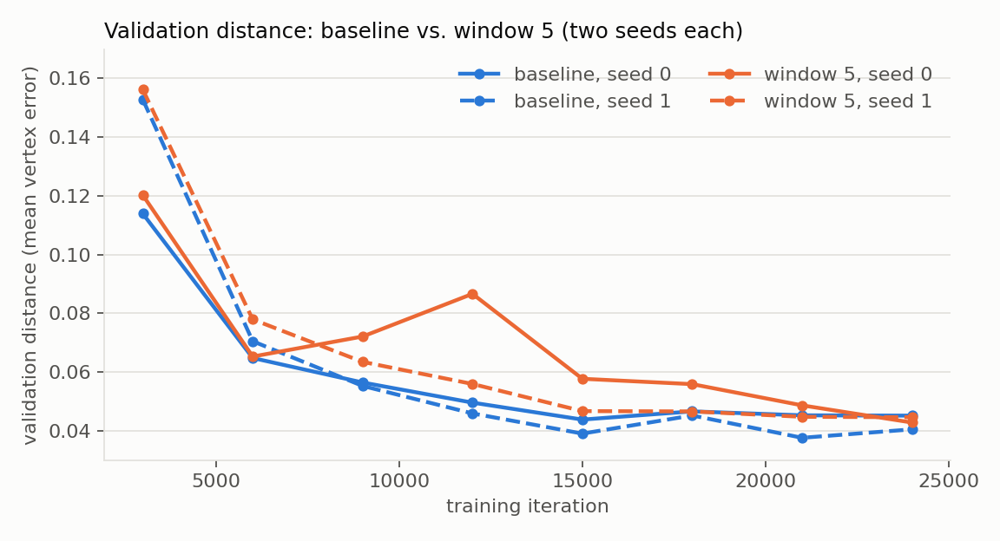
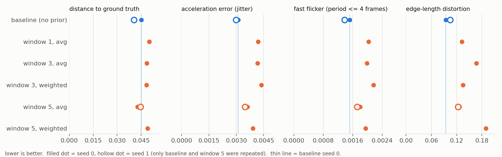

# SFMT: a window prior for skeleton-free motion transfer — and a replication that checks whether it works

Code for **3D Motion Transfer Across Diverse Character Topologies**, built on
[*Skeleton-free Pose Transfer for Stylized 3D Characters*](https://zycliao.com/sfpt) (SFPT, Liao et al., ECCV 2022).

SFPT transfers a pose from a source character to a target character frame by frame, so a motion played back
this way can jitter. Our extension (the **window prior**) feeds the decoder an aggregate of the encodings of the last `N`
*predicted* frames, in the hope of smoother motion:

| variant | command |
|---|---|
| baseline (original SFPT, no prior) | `python train.py --window 0` |
| window `N`, plain average of the last `N` encodings | `python train.py --window N --agg avg` |
| window `N`, weighted average (weights 2^i, newest highest) | `python train.py --window N --agg weighted_avg` |

This repository contains the unified code for all variants, the pipeline that rebuilds the Mixamo training data, and a
**controlled re-run of the experiments with quantitative jitter metrics**.

> **Short version of the result.** In this re-run the window prior did **not** reduce jitter. It is not better in distance
> to the ground truth, and it is measurably *jerkier* than the baseline. Details, caveats and the numbers are below.
> The original project report supported its claim qualitatively (rendered figures and a video); it contained no
> quantitative jitter measurement.

## Results

Setup: 24,000 training iterations per run (batch of 2 pose pairs), validation every 3,000 iterations, evaluation on
10 clips of 60 frames (2 unseen characters, 600 frames) of the final checkpoint. Everything below is on the **6 Mixamo characters
that were available** (4 train, 2 test) — far less character diversity than the original paper/report. The baseline and
window 5 were run with two seeds (seed changes both model initialisation and the training data schedule); the other settings
have one seed. All 8 runs had 0 non-finite frames in all validations.



| run | final val. distance | mean of last 3 val. distances | acceleration error | fast flicker | edge-length distortion |
|---|---|---|---|---|---|
| baseline, seed 0 | 0.0452 | 0.0457 | **0.00311** | **0.00152** | **0.095** |
| baseline, seed 1 | 0.0405 | 0.0411 | **0.00298** | **0.00138** | 0.105 |
| window 1, avg | 0.0501 | 0.0551 | 0.00419 | 0.00203 | 0.132 |
| window 3, avg | 0.0486 | 0.0503 | 0.00416 | 0.00198 | 0.167 |
| window 3, weighted | 0.0484 | 0.0488 | 0.00438 | 0.00217 | 0.135 |
| window 5, avg, seed 0 | 0.0428 | 0.0491 | 0.00362 | 0.00180 | 0.127 |
| window 5, avg, seed 1 | 0.0446 | 0.0453 | 0.00347 | 0.00172 | 0.123 |
| window 5, weighted | 0.0492 | 0.0496 | 0.00391 | 0.00195 | 0.189 |

Lower is better in every column. Per-clip values for every run: [`results/metrics_per_clip.json`](results/metrics_per_clip.json);
tables: [`results/summary.csv`](results/summary.csv), [`results/validation_curves.csv`](results/validation_curves.csv).



What the data support:

- **Distance to ground truth: no window effect.** Window 5 minus baseline is −0.0024 with seed 0 and +0.0041 with seed 1; the
  baseline's own seed-to-seed difference (0.0047) is larger than either. The mid-training validation curves of the windowed runs
  are bumpier than the baseline's.
- **Jitter: the window prior is worse, consistently.** Window 5 has about 16% higher acceleration error in both seeds,
  18–25% more fast flicker and 8–12% higher jerk error, and 17–34% more edge-length distortion than the baseline of the same seed. For
  acceleration error and fast flicker the gap is larger than the baseline's seed-to-seed spread (about 4x and 2x); for jerk error
  it is not clearly larger than window 5's own seed spread. The single-seed windowed runs (windows 1 and 3, weighted window 5) are
  all worse than the baseline on these metrics, with the same sign, but we cannot separate them from noise individually.
- **Not explained by error build-up alone.** The error grows only 7–17% from the first to the last frames of a clip in every
  run, baseline included, and most windowed runs are already worse in the first 10 frames (where the prior is empty or short).

Limitations: one or two seeds, 10 test clips from 2 characters, a short training budget (24k iterations), humanoids only.
The report's humanoid-to-quadruped observation was **not** tested. Perceptual smoothness that none of these metrics capture
is not measured. We therefore claim "no evidence of a jitter reduction in this setup", not that the idea cannot work.

### Metrics

Computed by [`tools/extra_metrics.py`](tools/extra_metrics.py) from the meshes of the final validation (`.ply` dumps),
per 60-frame clip, in mesh units (the characters are normalised). `gt` = ground-truth target mesh, `pred` = prediction.

| name | definition |
|---|---|
| distance | mean per-vertex Euclidean error (the quantity validation reports) |
| acceleration error | mean norm of the second temporal difference of `pred - gt` per vertex |
| jerk error | same with the third difference |
| fast flicker | norm of the part of the per-vertex error trajectory with period <= 4 frames (FFT high-pass), averaged |
| edge-length distortion | mean `abs(len_pred - len_gt)` over mesh edges, divided by the mean ground-truth edge length |
| 95th-percentile error | per-frame 95th percentile of the vertex errors, averaged over frames |

## Setup

```bash
# Python 3.10, CUDA 11.6 build of PyTorch 1.13.1 (see requirements.txt for the exact wheels and versions)
python -m venv .venv && source .venv/bin/activate
pip install -r requirements.txt            # read the two comment lines at the top for the torch / PyG wheels
cp .env.example .env && $EDITOR .env && source .env
```

`env.sh` is a convenience that activates the venv (`./.venv` or `../.venv`) and sets default data paths
(`../data`, `../runs` unless `SFMT_DATA` / `SFMT_LOG_DIR` are set). All paths are environment variables read in `global_var.py`.

## Data

The Mixamo data are **not redistributed** (Mixamo terms). You need your own copy of some Mixamo characters (T-pose `.fbx`) and
animations (`.fbx`, one character is enough). `tools/` rebuilds everything with headless Blender (tested with 4.2.3):

```bash
# animations: .fbx -> .bvh (Y-up, XYZ Euler, root transform only)
blender -b --python tools/blender_fbx_to_bvh.py -- <fbx_dir> <data>/Mixamo/Mix_bvh_ani
# characters: .fbx -> rest-pose .obj + RigNet-style rig / skinning ground truth
blender -b --python tools/blender_char_export.py -- <data>/Mixamo <name>=<file.fbx> [<name>=<file.fbx> ...]
# then the preprocessing inherited from SFPT (decimation to < 5k faces, npz, 60-frame clips; steps 6-8 of README_upstream.md):
python data_proc/mixamo_simplify.py && python data_proc/mixamo_preproc_simplify.py && python data_proc/mixamo_motion_preproc.py
# validation pairs from the test characters that exist on disk
python tools/make_validation.py <data>/Mixamo/Mixamo_simplify_new
```

Expected layout (see `.env.example`): `Mixamo_simplify_new/{npz/<character>.npz, motion60/<motion>.npy, motion60_{train,test}.txt,
mo60_character_{train,test}.txt, validation.txt}`. The split lists we used are in [`splits/`](splits/); the characters that
had a matching `.npz` here were `Ch20_nonPBR, Ch45_nonPBR, eve_j_gonzales, pumpkinhulk_l_shaw` (train) and
`Ch11_nonPBR, Ch44_nonPBR` (test) with 1,200 train / 64 test motions of 60 frames. Characters listed in a split but missing
on disk are skipped with a warning.

## Reproduce the experiments

```bash
source env.sh
./run_overnight.sh 24000 3000          # baseline, avg/weighted window 5 and 3, avg window 1, then two seed-1 replicates
ONLY="baseline_s1 avg_w5_s1" ./run_overnight.sh 24000 3000   # just the seed replicates
```

Each run needs about 2 hours on a GTX 1650 (4 GB, thermally throttled): about 3 iterations per second. Outputs go to `/dev/shm`
and are mirrored to `runs/` (the script resumes interrupted runs from `latest.pth`). Then:

```bash
python tools/extra_metrics.py runs/metrics_all.json baseline avg_w1 avg_w3 weighted_w3 avg_w5 weighted_w5 baseline_s1 avg_w5_s1
python tools/compare_runs.py runs/metrics_all.json          # tables + paired comparisons + seed spread
python tools/make_report_assets.py runs results             # regenerates results/ and the figures
```

`train.py --help` lists all options (`--window`, `--agg`, `--seed`, `--max_iters`, `--val_every`, `--save_ply`, `--wandb`, ...).
How the code was made ~4.7x faster and the schedule/reliability design: [`docs/PERFORMANCE.md`](docs/PERFORMANCE.md).

## What changed relative to the original code

- One `train.py` replaces the per-experiment copies of the code; window size, aggregation, epochs, validation interval and seed are command-line options.
- Cluster-specific paths became environment variables; debug `exit()` calls and stray debug dumps were removed.
- Validation: per-pass accumulators (the original averaged over *all* validations so far), non-finite frames of a diverged rollout are skipped and counted.
- Speed: sync-free per-graph operations, GPU farthest-point sampling, an exact reformulation of the first EdgeConv layer, a stateless data schedule with loader workers, no dead forward pass.
- Data tools: Blender pipeline to rebuild the Mixamo motion data (`tools/`).

## Not tested / known gaps

- `demo.py` / `demo_smpl.py` are inherited from SFPT and were **not** re-run in this fork (the decoder here takes an extra prior input).
- AMASS / RigNet / SMPL training paths are inherited and unused here (`prob=(0, 1, 0)` = Mixamo only).

## License, credits and citation

This work is derived from Adobe's SFPT code, released under the **Adobe Research License** ([`LICENSE.txt`](LICENSE.txt)):
**noncommercial research use only**, and the license text and this restriction must be kept in copies and derivatives.

The original SFPT README is kept as [`README_upstream.md`](README_upstream.md). If you use this code, please cite SFPT:

```
@inproceedings{liao2022pose,
    title = {Skeleton-free Pose Transfer for Stylized 3D Characters},
    author = {Liao, Zhouyingcheng and Yang, Jimei and Saito, Jun and Pons-Moll, Gerard and Zhou, Yang},
    booktitle = {European Conference on Computer Vision ({ECCV})},
    year = {2022},
}
```

The window-prior idea and the original experiments: Jayadratha Gayen and Madhavaram Vivek Vardhan, *Skeleton-free Animation for
Stylized Characters*, Topics in Deep Learning project report, IIIT Hyderabad, 2023. SFPT in turn borrows code from
[TailorNet_dataset](https://github.com/zycliao/TailorNet_dataset), [RigNet](https://github.com/zhan-xu/RigNet),
[face3d](https://github.com/YadiraF/face3d) and [shape_pose_disent](https://github.com/kzhou23/shape_pose_disent).
